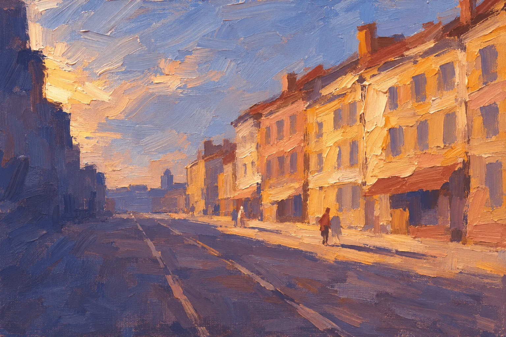
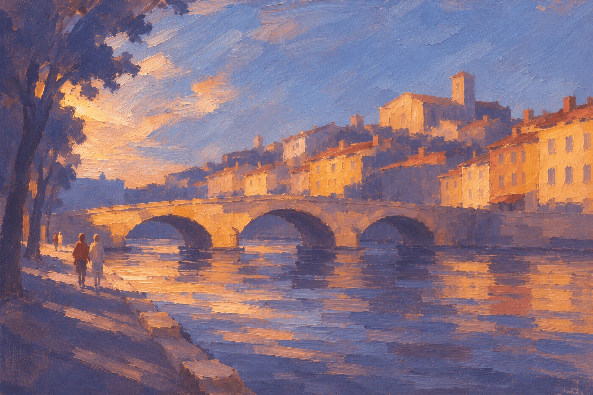
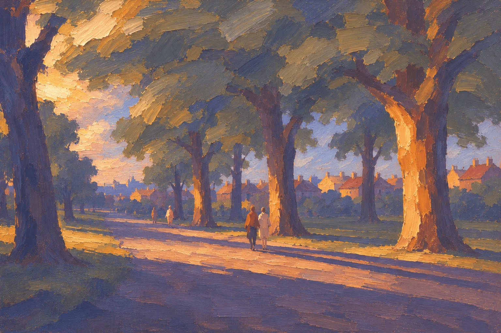
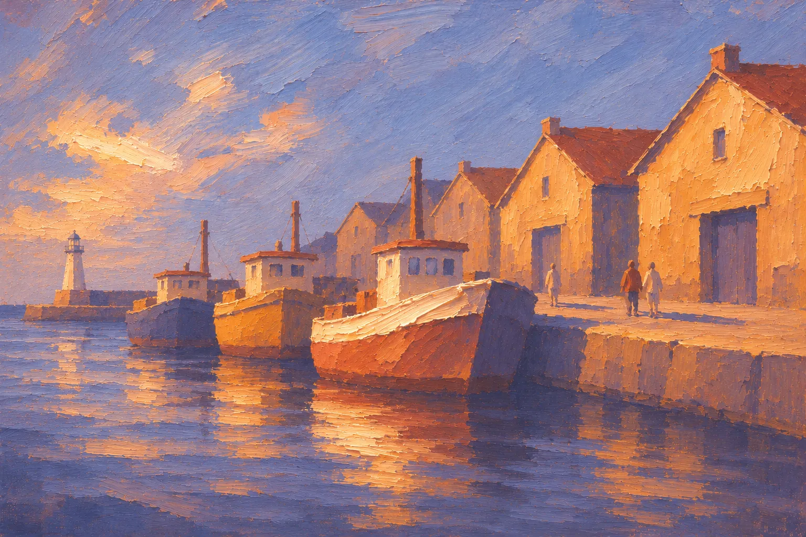
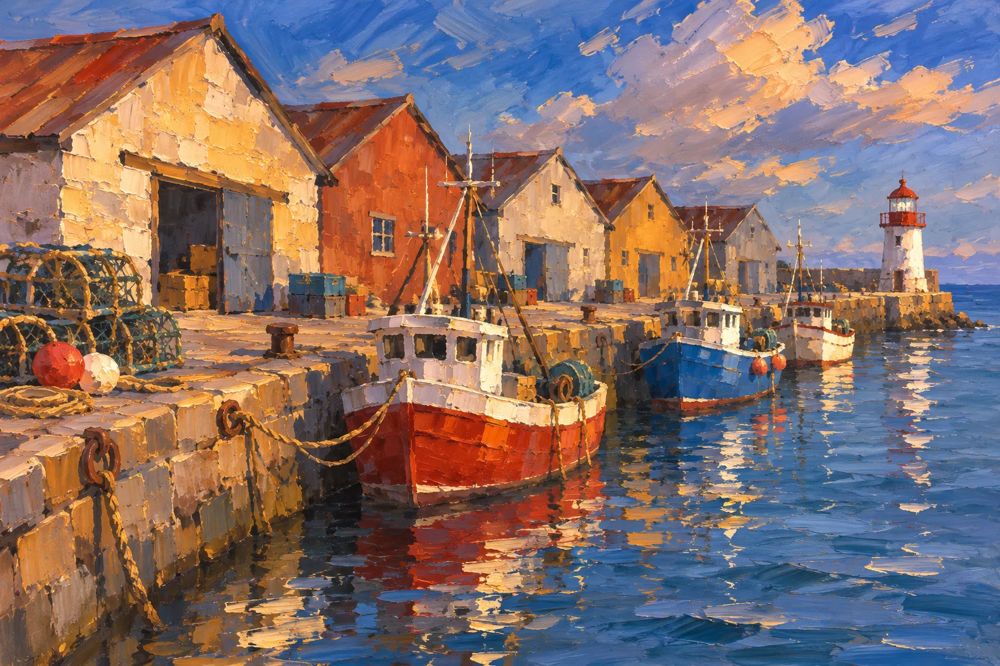
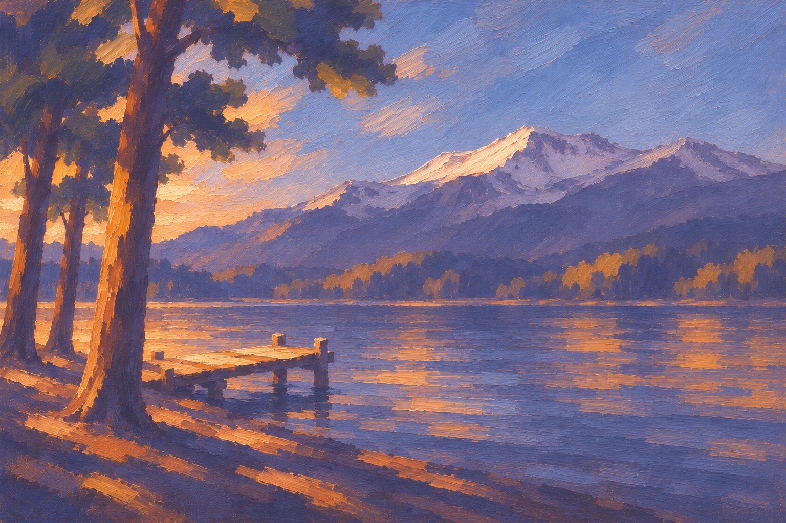
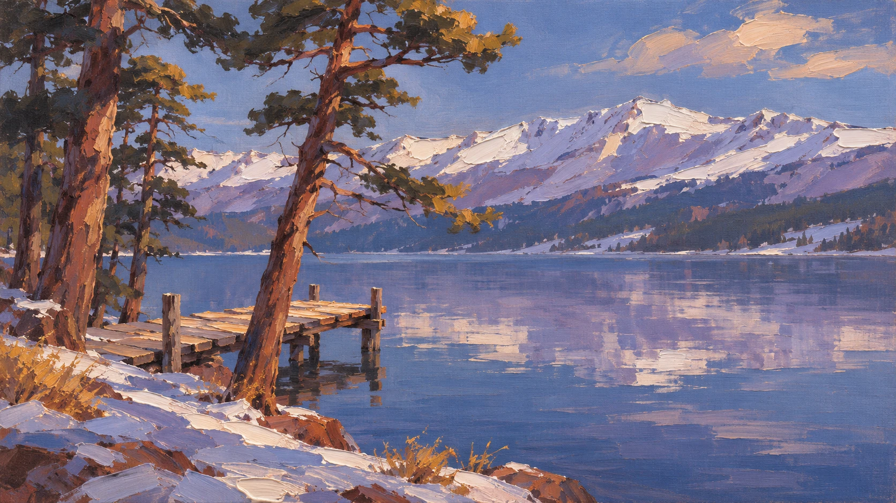

# Image prompt kit

One more picture in a style that already exists, out of ChatGPT, without the style
drifting. The kit is two things: [`prompt.txt`](prompt.txt), a prompt that locks the
style and leaves a slot for the subject, and [`references/`](references), a fixed set of
pictures. The example is a series of oil-painted landscapes; the method works for any
set of pictures.

## 1. Set up ChatGPT

Once. Needs a plan with projects and image generation.

1. Create a project, for example "Oil landscapes".
2. Open the project, click the three-dots icon (**⋯**) → **Project settings** → **Instructions**, and paste in the whole of [the prompt](#the-prompt) ([`prompt.txt`](prompt.txt)). Save.
3. Add the three [reference images](#reference-images) ([`references/`](references)) to the project's files ("Sources").

No projects? Attach the three pictures and paste the prompt at the top of each new chat.

## 2. Make a picture

1. Start a new chat in the project and name one place:

   ```text
   PLACE: a harbour with fishing boats and a row of warehouses
   EXTRA: a lighthouse at the far end of the quay
   ```

2. Compare the result with the references side by side, at the same size.
3. Ask for changes in the same chat: "broader strokes", "greyer", "the painting only,
   no frame".
4. One picture per chat. Never add a generated picture to the references: each one is a
   little off, and the error adds up.

## The prompt

```text
OIL PAINTING LANDSCAPE — STYLE LOCK
Paint a new landscape that strictly matches the attached reference paintings. Treat the
references as an established series: every new picture must look painted by the same
artist in the same week, with the same brush size, the same palette and the same light.

1. Paint, not a photo
* A real oil painting on canvas, painted wet-on-wet in one sitting. Not a photo with a
  filter, and not a smooth digital painting.
* Every shape is built from visible strokes of a flat brush or a palette knife. Thick
  paint in the lights, thin scrubbed paint in the shadows.
* The smallest stroke is about 1/80 of the picture's width. Anything smaller than one
  stroke is left out.

2. Simplification
* A window is one stroke. A distant figure is two or three. A tree is five to ten.
* Edges are soft or broken, except where the lightest light meets the darkest dark.
* No fine lines, no lettering, no readable signs, no faces.
* When uncertain, simplify rather than add detail.

3. Colour
* The references' limited palette: ultramarine blue, burnt sienna, yellow ochre, one
  warm red, white. Every colour in the picture is a mix of these.
* No pure black, no neon, no green straight from the tube. Greens are greyed with red
  or sienna.
* Warm lights, cool shadows.

4. Light
* One low sun, late afternoon, from the left. Long shadows falling to the right.
* About two thirds of the picture in shadow or half-tone, one third in light.
* The brightest, thickest paint is in one place only.

5. Composition
* Landscape format, 3:2. The horizon about one third up from the bottom edge.
* Seen from standing height. No wide-angle distortion, no aerial view.
* One clear subject, with quieter, broader strokes around it.
* Paint runs to all four edges. No frame, border, signature, easel, wall or hand.

6. Check
Before finishing, compare with the references for stroke size, palette, the direction
of the light and the amount of detail, and correct anything that differs.

MOST IMPORTANT: change the PLACE only, never the way it is painted. The attached
references are the source of truth.

PLACE: [ONE PLACE — e.g. "a harbour with fishing boats", "a mountain lake with pines"]
EXTRA: [OPTIONAL — something to include or keep]
```

## Reference images

| [`street.webp`](references/street.webp)                                | [`river.webp`](references/river.webp)                                 | [`park.webp`](references/park.webp)                             |
| ---------------------------------------------------------------------- | --------------------------------------------------------------------- | --------------------------------------------------------------- |
|  |  |  |
| Buildings in light and shadow: hard edges, windows                     | Water and sky: reflections, soft edges, wide strokes                  | Trees and distance: how green is greyed, how things fade        |

## Samples

Two places that are not in the references, each made with the kit and with a plain
prompt. First results, not the best of several.

| | With the kit | Plain prompt, no kit |
| --- | --- | --- |
| **Harbour** |  |  |
| **Lake** |  |  |

With the kit:

```text
PLACE: a harbour with fishing boats and a row of warehouses
EXTRA: a lighthouse at the far end of the quay
```

```text
PLACE: a mountain lake with pines on the near shore and a snow-capped ridge behind
EXTRA: a small wooden jetty on the left
```

Plain, in a chat with no project and no references: "An oil painting of a harbour with
fishing boats and a row of warehouses, with a lighthouse at the far end of the quay."
The lake was asked for the same way.

The plain pictures are good paintings, each by a different painter: brighter colours,
finer detail, their own light and format. The kit's two belong on the same wall as the
references.

## Why the prompt works

The pictures carry the style; the prompt only says what to keep. Shown three paintings, a
model has to guess what they share. The prompt answers that, and nothing else.

| In the prompt                                                    | Why                                                                                                                  |
| ---------------------------------------------------------------- | -------------------------------------------------------------------------------------------------------------------- |
| "STYLE LOCK … strictly matches the attached reference paintings" | Puts the pictures above the words. Otherwise references are treated as loose inspiration.                            |
| "an established series … the same artist in the same week"       | Asks for sameness. "In the style of" only asks for a resemblance.                                                    |
| No painter is named                                              | A name brings that painter's subjects with it, and may be refused. Technique in plain words is repeatable.           |
| Section 1 first: "Not a photo with a filter"                     | Sections are ordered by how often a generator gets them wrong. For paint, that is a photo with brush texture on top. |
| "The smallest stroke is about 1/80 of the picture's width"       | A number can be checked; "loose brushwork" cannot. It also caps the detail.                                          |
| "A window is one stroke"                                         | Detail counted in strokes. Asked for "simplified", a model still draws window frames.                                |
| Five named pigments, "every colour is a mix of these"            | A short palette is most of what makes separate pictures read as one series.                                          |
| "No pure black, no neon, no green straight from the tube"        | Each "no" names one specific failure. A general "no bright colours" is ignored.                                      |
| "One low sun … from the left", "two thirds … in shadow"          | One default, not a choice, and a ratio for the overall tone. Light from the other side reads as a different series.  |
| "3:2 … horizon one third up … standing height"                   | Format and viewpoint are part of the style. Left open, each picture picks its own.                                   |
| "No frame, border, signature, easel, wall or hand"               | Ask for "an oil painting" and you often get a picture of one, framed on a wall.                                      |
| "MOST IMPORTANT: change the PLACE only"                          | The rule repeated last, where it weighs most.                                                                        |
| `PLACE:` and `EXTRA:` as the last lines                          | The locked part is never edited, so nobody breaks the style by rewording it.                                         |

Outside the prompt: a **project** delivers the same instructions and files to every chat,
and the **same originals every time** keep the series from walking away from itself.

## Make a kit for your own style

1. Finish the set first: three pictures at least, each chosen for a reason.
2. Write one section per thing a generator will get wrong, most likely first, with numbers.
3. End with the lock and the slots.
4. Run it on five subjects. Every miss you see becomes one "no"; a rule nobody has seen
   broken comes out.
5. Note the model and the date. Image models change, and a style lock is tuned to one.

<!-- TODO: Tested with <model>, <date>. Licence. -->
